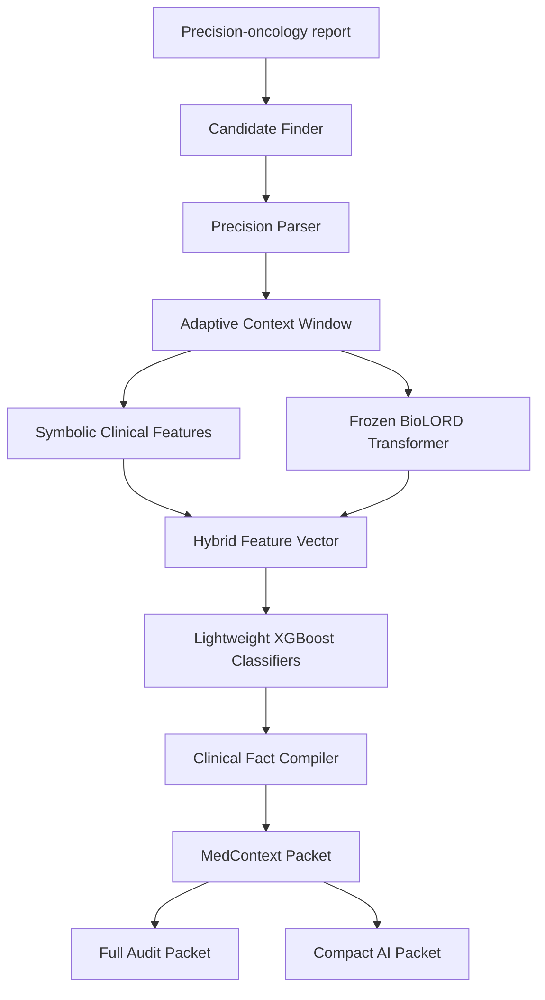
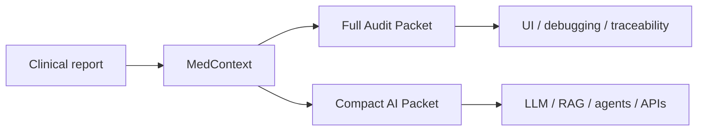

# MedContext Precision Oncology  🧬

**MedContext Precision Oncology** is a lightweight neuro-symbolic pipeline that converts unstructured precision-oncology reports into **structured, contextualized clinical facts**.

Instead of sending an entire clinical report directly to an LLM, RAG system, or AI agent, MedContext extracts the relevant molecular findings and represents their meaning explicitly:

- What biomedical entity was mentioned?
- Is the finding present, absent, or uncertain?
- Does it refer to the patient or a family member?
- Is it current or historical?
- Is it confirmed or suspected?

The result is a machine-readable representation that can be used by downstream AI systems without requiring them to reinterpret the complete source report.

> Research and hackathon prototype. Not intended for clinical decision-making.

---

## Why MedContext?

Precision-oncology reports contain molecular findings mixed with negation, temporal information, uncertainty, family history, methodology, and other clinical text.

A molecular entity alone is not enough.

For example:

```text
PML::RARA was previously detected, but current testing was negative for PML::RARA.
```

contains two different clinical facts:

```text
PML::RARA → PRESENT → HISTORICAL
PML::RARA → ABSENT  → CURRENT
```

MedContext converts these contextual relationships into explicit structured data.

---

## Pipeline



---

## How it works

### 1. Biomedical entity detection

A deterministic vocabulary and regex-based **Candidate Finder** identifies known precision-oncology entities such as:

- genes;
- variants;
- gene fusions;
- biomarkers;
- drugs.

Entity mentions are preserved with exact character offsets.

### 2. Precision molecular parsing

The **Precision Parser** converts detected concepts into structured molecular representations.

Example:

```text
EGFR p.L858R
```

becomes:

```text
gene: EGFR
alteration: protein substitution
reference amino acid: L
position: 858
alternate amino acid: R
```

### 3. Adaptive context extraction

MedContext extracts the smallest clinically useful context around each entity.

It normally keeps one sentence but can expand to an adjacent sentence when continuation cues such as `however`, `later`, or `repeat sequencing` indicate that the finding is being updated.

### 4. Symbolic clinical features

Explicit clinical cues are converted into interpretable numerical features:

```text
negation
uncertainty
historical context
current context
family context
confirmation
cue-to-entity distance
```

### 5. Frozen biomedical Transformer

Each context window is encoded with the pretrained **BioLORD-2023** sentence Transformer.

The model remains frozen and produces a **768-dimensional biomedical semantic embedding**.

No Transformer fine-tuning is required.

### 6. Hybrid representation

The semantic embedding is concatenated with the symbolic rule features:

```text
9 symbolic features
+
768 BioLORD features
=
777-dimensional hybrid vector
```

### 7. Lightweight contextual classification

Four independent XGBoost classifiers predict:

```text
Assertion:
PRESENT / ABSENT / POSSIBLE

Experiencer:
PATIENT / FAMILY

Temporality:
CURRENT / HISTORICAL

Certainty:
CONFIRMED / SUSPECTED
```

### 8. Clinical Fact Compiler

The molecular representation and contextual predictions are merged into a structured Clinical Fact.

Example:

```json
{
  "entity": "IDH1 p.R132H",
  "type": "VARIANT",
  "assertion": "POSSIBLE",
  "experiencer": "PATIENT",
  "temporality": "CURRENT",
  "certainty": "SUSPECTED"
}
```

---

## Two output formats

MedContext produces two representations for different use cases.



### Full Audit Packet

Preserves:

- original report;
- source contexts;
- molecular parsing;
- offsets;
- confidence scores;
- report summary.

It is designed for **auditability, debugging, and human inspection**.

### Compact AI Packet

Removes redundant audit information and keeps only the clinically relevant structured facts.

It is intended for:

- RAG pipelines;
- LLM applications;
- AI agents;
- APIs;
- downstream clinical analytics.

This representation is the token-efficient output of MedContext.

---

## Synthetic benchmark

The MVP uses a controlled synthetic precision-oncology dataset generated from curated oncology vocabulary and clinical templates.

Covered examples include:

- AML;
- APL;
- B-ALL;
- NSCLC.

Contextual scenarios include:

```text
positive findings
negative findings
uncertainty
historical findings
family findings
conflicting temporal findings
```

A conflicting example explicitly contains two entity mentions so that each clinical state has its own ground-truth span and label.

---

## Results

The held-out synthetic test set contained **24 reports and 108 contextualized entity mentions**.

### End-to-end evaluation

| Metric | Result |
|---|---:|
| Fact extraction precision | 1.000 |
| Fact extraction recall | 1.000 |
| Fact extraction F1 | 1.000 |
| Assertion macro F1 | 1.000 |
| Experiencer macro F1 | 1.000 |
| Temporality macro F1 | 0.961 |
| Certainty macro F1 | 1.000 |
| Exact four-target context match | 0.963 |

### Inference efficiency

| Metric | Result |
|---|---:|
| Mean latency | 0.094 s/report |
| Median latency | 0.086 s/report |
| P95 latency | 0.156 s/report |

These results validate the architecture on the **controlled synthetic benchmark** and should not be interpreted as clinical validation on real-world patient data.

---

## Streamlit demo

The interactive demo supports:

- predefined oncology examples;
- manually pasted reports;
- `.txt` report uploads;
- Clinical Fact visualization;
- molecular interpretation;
- confidence inspection;
- Full Audit Packet export;
- Compact AI Packet export.

Run locally:

```bash
streamlit run app/app.py
```

---

## Repository structure

```text
medcontext-precision-oncology/
├── app/
│   └── app.py
├── data/
│   ├── vocabulary/
│   ├── synthetic/
│   └── processed/
├── results/
│   ├── models/
│   └── evaluation outputs
├── scripts/
├── src/
├── requirements.txt
├── README.md
└── LICENSE
```

---

## Tech stack

```text
Python
BioLORD-2023
Sentence Transformers
XGBoost
scikit-learn
PyYAML
pandas
NumPy
Streamlit
```

---

## Potential downstream applications

MedContext is designed as an **AI infrastructure primitive**, not as a final clinical decision system.

Its structured facts could be consumed by:

```text
RAG systems
clinical AI agents
LLM applications
precision-medicine analytics
clinical search
decision-support pipelines
EHR integration layers
```

---

## Limitations

The current MVP:

- uses a controlled synthetic benchmark;
- relies on a curated oncology vocabulary;
- does not provide clinical recommendations;
- has not been validated on real-world patient reports;
- supports a limited set of molecular and contextual patterns.

Real clinical deployment would require broader datasets, external validation, terminology standardization, calibration, safety evaluation, and clinical oversight.

---

## Future work

Possible extensions include:

- evaluation on external de-identified clinical corpora;
- broader EHR support beyond precision oncology;
- FHIR-compatible output;
- adaptive semantic escalation for ambiguous cases;
- larger biomedical vocabularies and terminology mappings;
- direct integration with RAG systems and clinical AI agents.

---

## Core idea

```text
Unstructured clinical language
            ↓
Context-aware molecular facts
            ↓
Structured representation
            ↓
AI-ready clinical context
```

**MedContext turns precision-oncology text into structured facts that machines can reason over more efficiently.**
